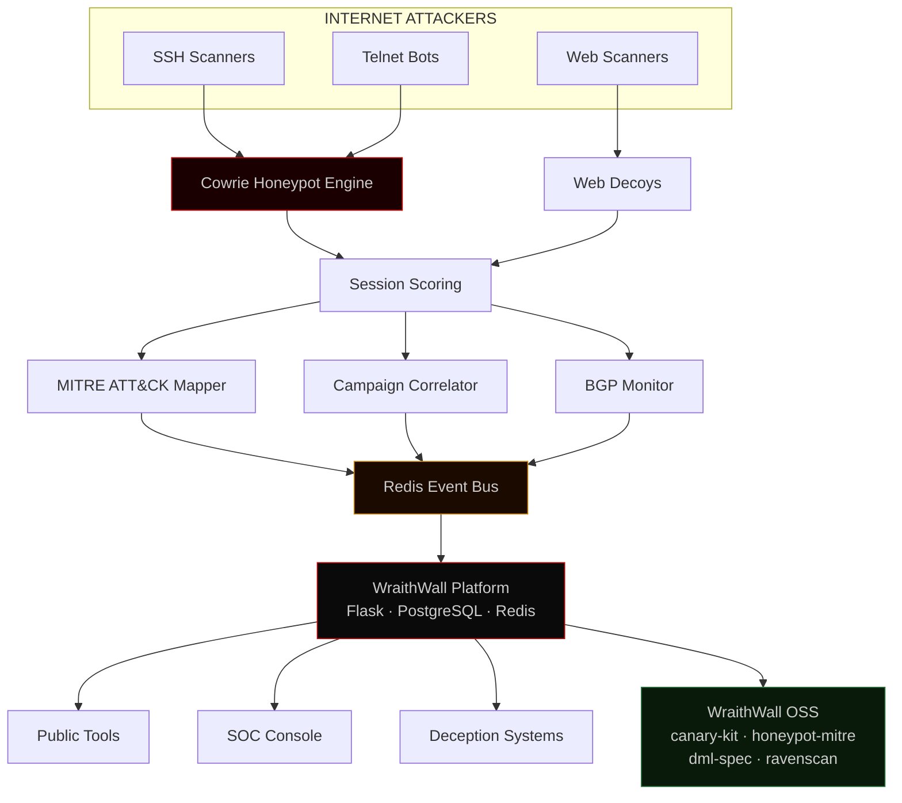

```
$ ssh operator@wraithwall.online
Authenticating .......................................
Session established       0x7f3a.be44
Threat telemetry          ████████████  ONLINE
Deception engine          ████████████  ARMED
Canary network            ████████████  ACTIVE
Identity confirmed.
```

<br>

<div align="center">

[](https://wraithwall.online)
[](https://github.com/niffyhunt/wraithwall)
[](#)
[](#)
[](#)

</div>

### [ BABALOLA ADEWALE ] · Lagos, Nigeria

I build deception infrastructure that turns attacker behavior into intelligence. My work sits at the intersection of honeypot operations, threat correlation, and applied security research. Every tool on this profile was extracted from something I learned running live adversary-facing systems.

---

## WHAT I BUILD

<details>
<summary><b>WraithWall</b> · Live deception platform with honeypots, BGP monitoring, and campaign correlation — running on internet traffic since 2025</summary>
<br>

```
STATUS:  PRODUCTION          LICENSE:  MIT (OSS components)
ROLE:    Flagship platform   TRAFFIC:  Live / 24h
```

A Flask monolith serving public threat tools, an authenticated SOC console, and seven background intelligence engines: Cowrie honeypot pipeline, MITRE ATT&CK mapper, campaign correlator, BGP monitor, canary token service, credential propagation engine, and LLM honeypot responder. Sessions are scored transparently via a deterministic formula — no black-box ML.

Attacker sessions flow through the platform in real time: Cowrie SSH/Telnet logs feed Redis, the correlator links sessions across IPs using HASSH fingerprints and credential reuse, and the MITRE mapper classifies commands into ATT&CK techniques. Everything is cross-referenced against the canary network and BGP route anomalies.

[Repo](https://github.com/niffyhunt/wraithwall) · [Incident report: Outlaw/mdrfckr worm cluster](https://github.com/niffyhunt/wraithwall/blob/main/incidents/2026-05-31-outlaw-mdrfckr.md) · [Live platform](https://wraithwall.online) · [OSS toolkit](https://github.com/niffyhunt/wraithwall)

</details>

<details>
<summary><b>WraithWall OSS</b> · Four pip-installable MIT packages extracted from the platform — deception tooling for anyone</summary>
<br>

| Package | What it does |
|---|---|
| `canary-kit` | Mint and detect supply-chain canary tokens |
| `honeypot-mitre` | Cowrie logs → MITRE ATT&CK techniques with deterministic scoring |
| `dml-spec` | HMAC-signed, versioned Deception Markup Language |
| `ravenscan` | Engineering intelligence CLI and library — codebase auditing |

Each is independent. None depends on the platform. All ship with a CLI and test suite.

[Repo](https://github.com/niffyhunt/wraithwall)

</details>

<details>
<summary><b>BGP Monitor</b> · Real-time route anomaly detection via RIPE RIS Live + Cloudflare Radar</summary>
<br>

```
STATUS:  PRODUCTION    DATA:  RIPE RIS Live + Cloudflare Radar
ROLE:    Infrastructure intelligence
```

Learns prefix baselines and alerts within seconds on origin-AS changes, unauthorized announcements, and path anomalies. Built because the platform needed autonomous route monitoring without a commercial feed.

[Repo](https://github.com/niffyhunt/BGP-monitor)

</details>

<details>
<summary><b>RavenScan</b> · Engineering intelligence agent — traverses codebases, detects architectural change, produces evidence-backed reports</summary>
<br>

```
STATUS:  ACTIVE        TYPE:  CLI + SDK
ROLE:    Codebase intelligence
```

Started as internal tooling for WraithWall's own monorepo audits. Now a standalone CLI and library. Learns a project over time, correlates changes across revisions, and explains why changes matter — not just what changed.

[Source](https://github.com/niffyhunt/wraithwall/tree/main/packages/ravenscan)

</details>

<details>
<summary><b>+ also</b> · personal infrastructure & developer tooling</summary>
<br>

**[My Mini Cloud](https://github.com/niffyhunt/my-mini-cloud)** — self-hosted Heroku-like PaaS. Git-to-URL with automatic SSL and Docker isolation. **[Codeguard Copilot](https://github.com/niffyhunt/Codeguard-copilot)** — VS Code extension for real-time vulnerability detection with CWE references.

</details>  

---

<details open>
<summary><b>⊳ ARCHITECTURE</b></summary>
<br>



The platform captures attacker behavior. The toolkit extracts reusable components. Companion tools solve adjacent problems.

</details>

---

<details open>
<summary><b>⊳ THREAT INTELLIGENCE PIPELINE</b></summary>
<br>

```
┌─────────────────────────────────────────────────────────────┐
│                    SIGNAL COLLECTION                         │
│                                                             │
│  Cowrie SSH/Telnet   Web Decoys   BGP Route Feeds           │
│  (sessions, cmds,    (credential  (RIPE RIS Live,           │
│   downloads, tty)     captures)    Cloudflare Radar)         │
└─────────────────────────┬───────────────────────────────────┘
                          │
                          ▼
┌─────────────────────────────────────────────────────────────┐
│                    INTELLIGENCE LAYER                        │
│                                                             │
│  MITRE ATT&CK Mapper     Campaign Correlator                │
│  (T1098, T1059, T1082,   (cross-IP linking,                 │
│   T1003, T1048, etc.)     equivalence detection)             │
│                                                             │
│  HASSH Fingerprints      Geo-Velocity Checks                │
│  (client identification,  (impossible travel                 │
│   tool attribution)        detection)                        │
│                                                             │
│  LLM Enrichment          Deterministic Scoring              │
│  (optional narrative,     (transparent formula,             │
│   no required dependency)  stage-based weighting)            │
└─────────────────────────┬───────────────────────────────────┘
                          │
                          ▼
┌─────────────────────────────────────────────────────────────┐
│                    ACTIVE DEFENSE                            │
│                                                             │
│  Canary Tokens           HoneyFS Rotator                    │
│  (supply-chain, DNS,     (dynamic deception                 │
│   credential lures)       file generation)                   │
│                                                             │
│  LLM Honeypots           Credential Propagation             │
│  (adaptive decoys,       (planted creds across              │
│   multi-turn engagement)  monitored surfaces)                │
│                                                             │
│  Gateway Challenge        Abuse Auto-Reporting              │
│  (C2 beacon detection,   (ASN contact,                      │
│   adaptive difficulty)    RDNS lookup)                       │
└─────────────────────────────────────────────────────────────┘
```

</details>

---

<details open>
<summary><b>⊳ TECH STACK</b></summary>
<br>

**Backend & Platform**
<br>


**Security & Deception**
<br>


**Infrastructure & DevOps**
<br>


**Observability & Intelligence**
<br>


**Frontend**
<br>


</details>

---

<details open>
<summary><b>⊳ RESEARCH LABORATORY</b></summary>
<br>

```
EXPERIMENT                    STATUS        NOTES
─────────────────────────     ──────────    ──────────────────────────────
HoneyFS Dynamic Rotation      DEPLOYED      Automated deception file gen
Multi-Sensor Campaign Equiv   ACTIVE        WraithMesh distributed sensing
Deterministic ATT&CK Scoring  SHIPPING      No LLM dependency path
Adaptive Gateway Challenges   DEPLOYED      4-level C2 beacon escalation
Web Honeypot Decoys           LIVE          4 fake login pages on cowrie VPS
Per-IP LLM Budget Enforcement LIVE          20/day per src_ip throttle
Canary Token Auto-Rotation    PLANNED       Autonomous tripwire cycling
SIEM/Syslog Forwarding        PLANNED       Structured log egress
Cross-Honeypot Attribution    INVESTIGATING IP/credential/tooling linkage
```

```
INVESTIGATION LOG:
2026-07  Why do 93% of Cowrie sessions show command_count=0?
         → 75% are TCP scanners, 8% complete KEX then abandon
         → Not a configuration issue — traffic composition
         → Working on credential-lure seeding to attract interactors
```

</details>

---

<details>
<summary><b>⊳ WRITING</b></summary>
<br>

**[Technical Blog →](https://wraithwall.online/blog)**

```
RECENT:
· I Open-Sourced My Deception Toolkit, BGP Hijack Monitor Included
· Eighteen Months Running a Deception Platform Solo: What the Audit Found
· Two IPs, One SSH Key: Linking an Operator Across Networks
· Launching the Canary Token Service: Tripwires for $9/Month
· Cowrie to Campaigns: The Production Intelligence Pipeline
```

</details>

---

<details open>
<summary><b>⊳ CONTRIBUTE</b></summary>
<br>

All public repositories include `CONTRIBUTING.md` and `SECURITY.md`. If you work in threat intelligence, run a honeypot, or build detection tooling — your input matters.

```
Valuable contributions:
· Cowrie session samples with novel commands or tooling
· HASSH/JA3 fingerprints from observed attacker clients
· Campaign signatures — IP clusters, credential patterns, tool reuse
· MITRE ATT&CK technique suggestions for command mappings
· Bug reports with reproduction steps
· Threat intelligence feeds relevant to deception operations
```

</details>

---

<br>

<div align="center">

[](https://wraithwall.online)
[](https://wraithwall.online/blog)
[](https://x.com/Niffy_hunt)
[](https://www.linkedin.com/in/adewale-babalola-b85795395?utm_source=share_via&utm_content=profile&utm_medium=member_ios)
[](mailto:admin@wraithwall.online)

<br>

```
SESSION ACTIVE · 0x7f3a.be44 · THREAT TELEMETRY ONLINE
```

</div>
