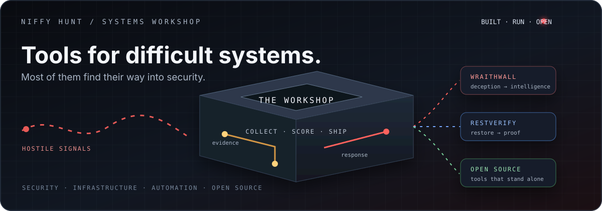
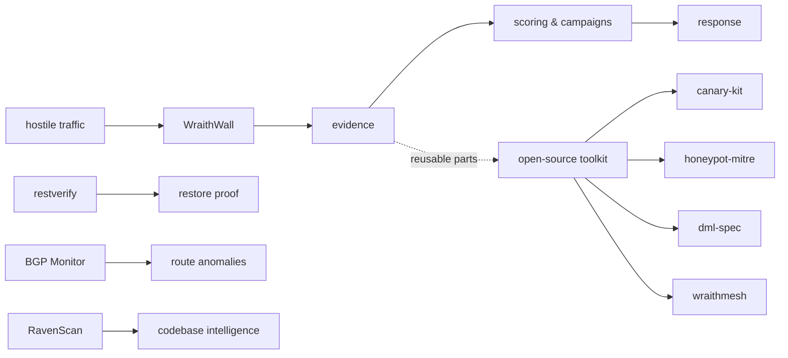

# Adewale Babalola

### Niffy Hunt · Lagos, Nigeria

**I build the tools I wish existed. Most of them find their way into security.**

> I build practical systems for difficult technical problems: deception and threat intelligence, restore verification, route monitoring, self-hosting, developer security, and the open-source tools that grow out of running those systems myself.

`SECURITY` · `INFRASTRUCTURE` · `AUTOMATION` · `OPEN SOURCE`

## Start here

| **Follow the live work** | **Inspect the tools** | **Read the thinking** |
|---|---|---|
| [Open WraithWall](https://wraithwall.online) · [read the docs](https://wraithwall.online/docs) | [WraithWall source](https://github.com/niffyhunt/wraithwall) · [OSS toolkit](https://github.com/niffyhunt/wraithwall-toolkit) | [Technical blog](https://wraithwall.online/blog) · [Security policy](https://github.com/niffyhunt/wraithwall/blob/main/SECURITY.md) |

## The work, at a glance

<b>How to read this map</b>

 

WraithWall is the centre of gravity: a self-hosted deception and threat-intelligence platform. The smaller projects are not a random list. Some are extracted components from that platform; others are independent tools built around problems that should have had better answers.

## Flagship systems

### [WraithWall](https://github.com/niffyhunt/wraithwall)

**Deception and threat intelligence for systems you operate yourself.**

Hostile SSH, Telnet, and web activity enters through honeypots and decoys. The platform records sessions, preserves evidence, maps behavior to MITRE ATT&CK techniques, links related activity, and gives an operator something they can investigate and act on.

   

### [restverify](https://github.com/niffyhunt/restverify)

**Because a backup is not verified until it restores.**

`restic check` validates the repository. `restverify` validates the restore: it restores a snapshot into a private temporary directory, compares it against the source tree, and returns exit codes that CI can act on. Read-only by construction, JSON on every command, with local history and a read-only dashboard.

 

## Open-source tools

| Project | Problem it addresses | Entry point |
|---|---|---|
| [WraithWall Toolkit](https://github.com/niffyhunt/wraithwall-toolkit) | Standalone deception-engineering components | [Explore the toolkit](https://github.com/niffyhunt/wraithwall-toolkit) |
| [RavenScan](https://github.com/niffyhunt/wraithwall/tree/main/packages/ravenscan) | Engineering-intelligence audits for codebases | [Read the package](https://pypi.org/project/ravenscan/) |
| [Canary Kit](https://pypi.org/project/canary-kit/) | Minting and detecting supply-chain canary tokens | [PyPI](https://pypi.org/project/canary-kit/) |
| [Honeypot MITRE](https://pypi.org/project/honeypot-mitre/) | Turning Cowrie logs into ATT&CK mappings and deterministic scores | [PyPI](https://pypi.org/project/honeypot-mitre/) |
| [DML Spec](https://pypi.org/project/dml-spec/) | Signed, versioned deception configuration | [PyPI](https://pypi.org/project/dml-spec/) |
| [WraithMesh](https://pypi.org/project/wraithmesh/) | Propagating signed observations across sensors | [PyPI](https://pypi.org/project/wraithmesh/) |
| [Raven Guard](https://pypi.org/project/raven-guard/) | Security analysis while code is being written | [Codeguard source](https://github.com/niffyhunt/Codeguard-copilot) |

The toolkit packages are designed to stand alone. They do not require Flask, a platform database, or the full WraithWall deployment.

## Other systems I run and build

### [BGP Monitor](https://github.com/niffyhunt/BGP-monitor)

Watches the global routing table through RIPE RIS Live, with optional Cloudflare Radar context, and learns a baseline for prefixes so origin-AS changes, unauthorized announcements, and route anomalies become visible.

### [Codeguard Copilot](https://github.com/niffyhunt/Codeguard-copilot)

Editor-time security analysis with deterministic multi-language patterns, CWE references, optional AI analysis, a CLI, and a VS Code extension. The CLI is published as [`raven-guard`](https://pypi.org/project/raven-guard/).

### [My Mini Cloud](https://github.com/niffyhunt/my-mini-cloud)

A self-hosted Git-to-URL deployment platform for personal services, static sites, and experimental applications, with Docker isolation and a simple dashboard.

## Released packages

| Package | Current public purpose | Registry |
|---|---|---|
| `wraithwall` | Self-hosted deception and threat intelligence | [PyPI](https://pypi.org/project/wraithwall/) |
| `restverify` | Restore verification for restic | [PyPI](https://pypi.org/project/restverify/) |
| `ravenscan` | Codebase intelligence CLI | [PyPI](https://pypi.org/project/ravenscan/) |
| `raven-guard` | Security analysis engine | [PyPI](https://pypi.org/project/raven-guard/) |
| `wraithmesh` | Distributed signed-observation mesh | [PyPI](https://pypi.org/project/wraithmesh/) |
| `canary-kit` | Supply-chain canary tokens | [PyPI](https://pypi.org/project/canary-kit/) |
| `honeypot-mitre` | Cowrie-to-ATT&CK analysis | [PyPI](https://pypi.org/project/honeypot-mitre/) |
| `dml-spec` | Signed deception configuration | [PyPI](https://pypi.org/project/dml-spec/) |

## Field notes

I write about the systems while they are running: what hostile traffic reveals, how campaigns connect, where a design fails under pressure, and what changes after the audit.

- [72 Hours, 3 Botnets: DeFi Validator Sprayer, Tencent Scanner, and X-UI Hunter Caught Live](https://wraithwall.online/blog/72-hours-of-ssh-attacks-3-botnets-exposed)
- [HUNTER-RECON: Dissecting an Automated Botnet Scanner Caught in Production](https://wraithwall.online/blog/hunter-recon-botnet-scanner-analysis)
- [Cowrie to Campaigns: The Production Intelligence Pipeline](https://wraithwall.online/blog/cowrie-pipeline-campaign-intelligence)
- [Two IPs, One SSH Key: Linking an Operator Across Networks](https://wraithwall.online/blog/two-ips-one-ssh-key)
- [Eighteen Months Running a Deception Platform Solo: What the Audit Found](https://wraithwall.online/blog/solo-deception-platform-audit)
- [I Open-Sourced My Deception Toolkit, BGP Hijack Monitor Included](https://wraithwall.online/blog/open-sourcing-the-wraithwall-toolkit)

## Collaborate

If you run a honeypot, build detection tooling, find a bug, or have evidence that would improve the work, open an issue or pull request on [WraithWall](https://github.com/niffyhunt/wraithwall). For a security issue, follow [WraithWall's SECURITY.md](https://github.com/niffyhunt/wraithwall/blob/main/SECURITY.md) or email [contact@wraithwall.online](mailto:contact@wraithwall.online) with the subject `Security disclosure`.

Useful contributions include novel Cowrie session samples, HASSH or JA3 fingerprints, MITRE ATT&CK mapping suggestions, reproducible bug reports, and documentation improvements.

     

`built in the open · run on infrastructure I operate`

