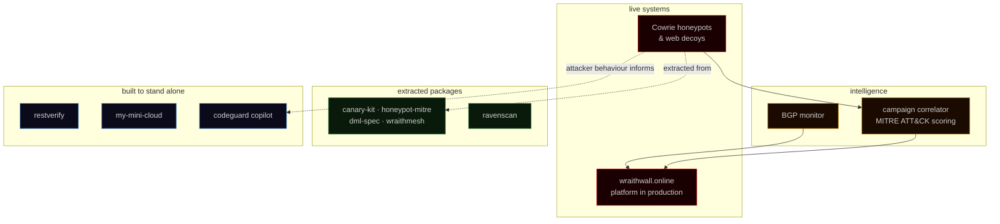

<div align="center">

# Adewale Babalola

### Niffy Hunt · Lagos, Nigeria

**I build tools, and most of them end up in security.**

[](https://wraithwall.online)
[](https://github.com/niffyhunt/wraithwall)
[](https://pypi.org/project/wraithwall/)
[](https://pypi.org/project/restverify/)

</div>

```text
 whoami
 ┌───────────────────────────────────────────────────┐
 │ builder · security engineer · system operator     │
 │ WraithWall (deception platform) runs in the open; │
 │ its reusable parts ship as MIT packages;          │
 │ the rest of the shelf exists because I needed it. │
 └───────────────────────────────────────────────────┘
   ▓▓▓▓▓▓▓▓▓▓▓▓▓▓▓▓▓▓▓▓▓▓▓▓▓▓▓▓▓▓▓▓▓▓▓▓▓▓▓▓▓▓▓▓▓▓▓
```

I run [WraithWall](https://github.com/niffyhunt/wraithwall) — a deception-and-threat-intelligence platform that takes hostile internet traffic and turns it into scored, correlated intelligence — and I keep extracting the reusable parts as small open-source tools. Around that sit the tools I wished existed: proof that a backup actually restores, a prefix monitor that watches BGP from the outside, a platform that deploys from Git, an editor that flags vulnerabilities while I type.

---

## ⊳ WHAT I BUILD

| Security & deception | Infrastructure & operations | Developer tools |
|---|---|---|
| [WraithWall](https://github.com/niffyhunt/wraithwall) — honeypots → intelligence | [BGP-monitor](https://github.com/niffyhunt/BGP-monitor) — hijack detection | [RavenScan](https://github.com/niffyhunt/wraithwall/tree/main/packages/ravenscan) — codebase intelligence |
| [WraithWall OSS](https://github.com/niffyhunt/wraithwall-toolkit) — MIT deception packages | [restverify](https://github.com/niffyhunt/restverify) — restore verification | [Codeguard Copilot](https://github.com/niffyhunt/Codeguard-copilot) — editor-time scanning |
| [WraithMesh](https://pypi.org/project/wraithmesh/) — sensor mesh | [My Mini Cloud](https://github.com/niffyhunt/my-mini-cloud) — Git-to-URL PaaS | |

---

## ⊳ SELECTED WORK

<details open>
<summary><b>WraithWall</b> · deception-and-threat-intelligence platform — hostile traffic in, scored intelligence out</summary>
<br>

```text
STATUS:  ACTIVE (v0.2.1 on PyPI)    LICENSE:  MIT
SOURCE:  github.com/niffyhunt/wraithwall
LIVE:    wraithwall.online
```

A Flask platform you self-host. Cowrie SSH/Telnet honeypots and web decoys capture hostile sessions; behavioural fingerprinting, campaign correlation and deterministic MITRE ATT&CK scoring turn them into intelligence; canary tokens, an active-defense gateway and incident playbooks turn intelligence into response. PostgreSQL for records, Redis for live state, SSE streams for the console — no SaaS dependency, nothing leaves your host.

- [Repository](https://github.com/niffyhunt/wraithwall) · [Live platform](https://wraithwall.online) · [Docs](https://wraithwall.online/docs) · `pip install wraithwall`

</details>


<details>
<summary><b>WraithWall OSS</b> · standalone MIT packages extracted from the platform — deception tooling for anyone</summary>
<br>

Five packages, each with its own CLI, tests and README. None imports Flask, a database, or the platform.

| Package | What it does | PyPI |
|---|---|---|
| `canary-kit` | Mint and detect supply-chain canary tokens | [0.1.0](https://pypi.org/project/canary-kit/) |
| `honeypot-mitre` | Cowrie logs → MITRE ATT&CK techniques + deterministic score | [0.1.0](https://pypi.org/project/honeypot-mitre/) |
| `dml-spec` | HMAC-signed, versioned deception configuration | [1.1.0](https://pypi.org/project/dml-spec/) |
| `wraithmesh` | Distributed sensor mesh with signed observations | [0.2.0](https://pypi.org/project/wraithmesh/) |
| `ravenscan` | Engineering-intelligence CLI (`raven`) for codebase audits | [0.2.1](https://pypi.org/project/ravenscan/) |

[Toolkit repository](https://github.com/niffyhunt/wraithwall-toolkit) · [RavenScan source](https://github.com/niffyhunt/wraithwall/tree/main/packages/ravenscan)

</details>

<details>
<summary><b>restverify</b> · prove your backups actually restore — restic restore-verification CLI</summary>
<br>

```text
STATUS:  RELEASED (v0.3.1 on PyPI)   DEPENDENCIES:  none
SOURCE:  github.com/niffyhunt/restverify
```

`restic check` validates the repository; restverify validates the *restore*. It restores a snapshot into a private temp directory, compares it against the source tree, and returns exit codes a shell or CI can act on — `0` verified, `2` differs, `1` failed. Read-only on the repository by construction, `--json` on every command, local history and a read-only dashboard.

- [Repository](https://github.com/niffyhunt/restverify) · `pip install restverify`

</details>

<details>
<summary><b>BGP Monitor</b> · real-time route-anomaly detection, watched from the outside</summary>
<br>

```text
STATUS:  RELEASED    LICENSE:  MIT    SIZE:  ~600 lines
SOURCE:  github.com/niffyhunt/BGP-monitor
```

Watches the global routing table for your prefixes over RIPE RIS Live, optionally cross-checked against Cloudflare Radar. Learns a baseline per prefix and alerts within seconds on origin-AS changes, unauthorised announcements and path anomalies — no BGP session of your own, no commercial feed. Drops into any Flask app as a blueprint; the same engine runs inside WraithWall.

- [Repository](https://github.com/niffyhunt/BGP-monitor)

</details>

<details>
<summary><b>+ also</b> · editor tooling & self-hosting</summary>
<br>

**[Codeguard Copilot](https://github.com/niffyhunt/Codeguard-copilot)** — catches vulnerabilities while you type: deterministic multi-language patterns with CWE references, optional AI analysis, VS Code extension source plus a CLI published as [`raven-guard`](https://pypi.org/project/raven-guard/).

**[My Mini Cloud](https://github.com/niffyhunt/my-mini-cloud)** — self-hosted Heroku-like PaaS: Git-to-URL deploys with automatic SSL and Docker isolation.

</details>

---

## ⊳ ECOSYSTEM MAP

What connects the work — capture at the edge, score it honestly, hand the operator something to act on; then pull the reusable pieces out and let them stand alone:

```text
 ┌── COLLECT ──────────────────────────────┐
 │  honeypots · web decoys · RIS feed      │
 └─────────────────────┬───────────────────┘
  ▒▒▒▒▒▒▒▒▒▒▒▒▒▒▒▒▒▒▒▒▒▒▒▒▒▒▒▒▒▒▒▒▒▒▒▒▒▒▒
 ┌── SCORE ────────────────────────────────┐
 │  ATT&CK mapping · campaigns · fingerprints │
 └─────────────────────┬───────────────────┘
  ▓▓▓▓▓▓▓▓▓▓▓▓▓▓▓▓▓▓▓▓▓▓▓▓▓▓▓▓▓▓▓▓▓▓▓▓▓▓▓▓
 ┌── RESPOND ──────────────────────────────┐
 │  playbooks · canaries · gateway         │
 └─────────────────────────────────────────┘
```



Stack: Python 3.10+ · Flask · PostgreSQL · Redis · Docker · Vue 3 · Vite · Tailwind · GitHub Actions — plus Cowrie, MITRE ATT&CK, RIPE RIS Live and Cloudflare Radar.


---

## ⊳ OPEN SOURCE · RELEASED TOOLS

Everything above is public and installable — the platform itself, five sibling packages, the editor CLI, and the backup verifier:

| Package | What it is | PyPI |
|---|---|---|
| `wraithwall` | The platform as a library + CLI | [0.2.1](https://pypi.org/project/wraithwall/) |
| `ravenscan` | Codebase intelligence (`raven`) | [0.2.1](https://pypi.org/project/ravenscan/) |
| `canary-kit` | Supply-chain canary tokens | [0.1.0](https://pypi.org/project/canary-kit/) |
| `honeypot-mitre` | Cowrie → ATT&CK + deterministic score | [0.1.0](https://pypi.org/project/honeypot-mitre/) |
| `dml-spec` | HMAC-signed deception configuration | [1.1.0](https://pypi.org/project/dml-spec/) |
| `wraithmesh` | Distributed sensor mesh | [0.2.0](https://pypi.org/project/wraithmesh/) |
| `raven-guard` | Security analysis engine (CodeGuard CLI) | [0.5.0](https://pypi.org/project/raven-guard/) |
| `restverify` | Restore verification for restic | [0.3.1](https://pypi.org/project/restverify/) |

WraithWall, the toolkit, BGP-monitor and `ravenscan` are MIT; the remaining projects carry their terms on their repositories.

---

## ⊳ WRITING

Field notes from running the platform — **[Technical Blog →](https://wraithwall.online/blog)**

- [72 Hours, 3 Botnets: DeFi Validator Sprayer, Tencent Scanner, and X-UI Hunter Caught Live](https://wraithwall.online/blog/72-hours-of-ssh-attacks-3-botnets-exposed)
- [HUNTER-RECON: Dissecting an Automated Botnet Scanner Caught in Production](https://wraithwall.online/blog/hunter-recon-botnet-scanner-analysis)
- [Cowrie to Campaigns: The Production Intelligence Pipeline](https://wraithwall.online/blog/cowrie-pipeline-campaign-intelligence)
- [Two IPs, One SSH Key: Linking an Operator Across Networks](https://wraithwall.online/blog/two-ips-one-ssh-key)
- [Eighteen Months Running a Deception Platform Solo: What the Audit Found](https://wraithwall.online/blog/solo-deception-platform-audit)
- [I Open-Sourced My Deception Toolkit, BGP Hijack Monitor Included](https://wraithwall.online/blog/open-sourcing-the-wraithwall-toolkit)

---

## ⊳ CURRENTLY

```text
wraithwall          v0.2.1 — platform iteration continues
wraithwall-toolkit  four deception packages maintained on PyPI
restverify          v0.3.1 released 2026-09-30
```

Plus whatever the honeypots teach me next — write-ups land on the blog.

---

## ⊳ COLLABORATE

If you run a honeypot, build detection tooling, or found something broken: open an issue or a PR on [wraithwall](https://github.com/niffyhunt/wraithwall) (its `CONTRIBUTING.md` and `SECURITY.md` say how), or report vulnerabilities through my [HackerOne profile](https://hackerone.com/niffy_hunt).

```text
especially useful:
· Cowrie session samples with novel commands or tooling
· HASSH/JA3 fingerprints from observed attacker clients
· MITRE ATT&CK mapping suggestions for command patterns
· bug reports with reproduction steps
```

---

## ⊳ CONTACT

<div align="center">

[](https://wraithwall.online)
[](https://wraithwall.online/blog)
[](https://x.com/Niffy_hunt)
[](https://www.linkedin.com/in/adewale-babalola-b85795395?utm_source=share_via&utm_content=profile&utm_medium=member_ios)
[](mailto:admin@wraithwall.online)
[](https://niffyhunt.online)

<br>

```text
built in the open · wraithwall.online
```

</div>
